# 👩🏻‍💻 Julia Costa

### Software Developer · Front-end & Full Stack

*Building things that make sense.*

Desenvolvedora de sistemas apaixonada por tecnologia, interfaces e pela construção de soluções que resolvem problemas reais.

Minha experiência está principalmente no desenvolvimento **Web e Mobile**, utilizando JavaScript, TypeScript, React e React Native. Também venho expandindo minha atuação para o backend, trabalhando com APIs, bancos de dados, autenticação e arquitetura de software.

Gosto de entender como as coisas funcionam por trás das interfaces, explorar diferentes tecnologias e construir aplicações que sejam não apenas bonitas, mas também funcionais, organizadas e escaláveis.

---

## `01` — Tech Stack

### Front-end & Mobile

<p>
  
  
  
  
  
  
  
  
</p>

### Back-end & APIs

<p>
  
  
  
  
  
</p>

### Databases & Infrastructure

<p>
  
  
  
  
  
</p>

### Tools & Workflow

<p>
  
  
  
</p>

---

## `02` — Featured Projects

### 🏥 ClinicFic

Aplicação web para gerenciamento de uma clínica odontológica, com foco em organização, usabilidade e experiência do usuário.

**Stack:** React · Vite · Tailwind CSS · shadcn/ui

🔗 [Live Demo](https://clinicfic.vercel.app/)

### 🎨 Atalier

Landing page desenvolvida para explorar design de interfaces, animações, composição visual e responsividade.

**Stack:** HTML · CSS · JavaScript

🔗 [Live Demo](https://atalier-lading-page.vercel.app/)

### 📦 Business Management Systems

Experiência no desenvolvimento de sistemas de gestão, incluindo aplicações para controle de operações, gerenciamento de dados, integrações e fluxos de trabalho.

### 📱 Mobile Applications

Desenvolvimento de aplicações mobile com React Native e Expo, envolvendo navegação, integração com APIs, autenticação e gerenciamento de estado.

---

## `03` — Currently Exploring

Estou constantemente expandindo meus conhecimentos, especialmente em:

- Arquitetura de software e Clean Architecture
- Desenvolvimento de APIs com Python e FastAPI
- SQL, PostgreSQL e modelagem de dados
- Autenticação, autorização e segurança
- Domain-Driven Design (DDD) e SOLID
- Docker e ambientes de desenvolvimento
- Sistemas SaaS e aplicações escaláveis
- Desenvolvimento mobile

---

## `04` — GitHub Activity

<p align="center">
  
  
</p>

---

## `05` — Beyond the Code

Tecnologia é uma das minhas grandes paixões, mas também gosto de explorar outras formas de criatividade.

Entre arte, música, design e novas ideias, acredito que boas soluções surgem justamente da curiosidade de olhar para as coisas de diferentes perspectivas.

```javascript
const julia = {
  occupation: "Software Developer",
  interests: [
    "Technology",
    "Software Architecture",
    "UI/UX Design",
    "Creative Projects",
    "Problem Solving"
  ],
  favoriteStack: [
    "JavaScript",
    "TypeScript",
    "React",
    "React Native",
    "Python"
  ],
  mindset: "Always learning, always building."
};
```

---

## `06` — Let's Connect

<p>
  <a href="https://github.com/JuliaCosta-dev">
    
  </a>
  <a href="https://www.linkedin.com/in/j%C3%BAlia-costa-7293a1316/">
    
  </a>
</p>

---

<p align="center">
  <i>Curiosity drives innovation. Code brings ideas to life.</i> 💙
</p>
